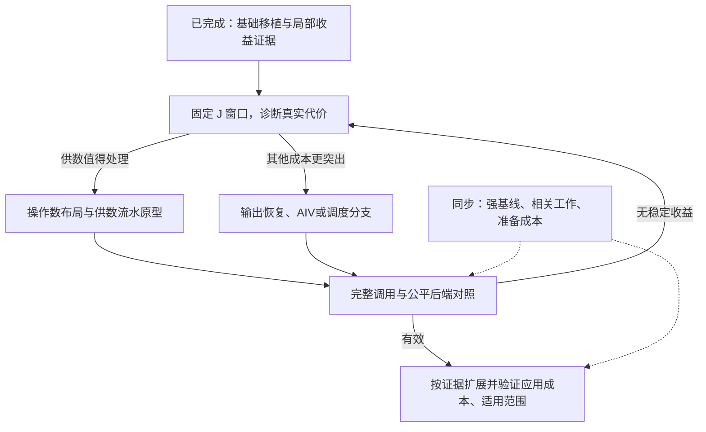

# RSH → Ascend 910B：项目资料总览

更新日期：2026-10-20。本文是跨阶段资料与决策入口，不是新增实验轮次。数字沿用已有分析和审计，不把不同阶段的时间或速度比拼成新的项目总成绩。

## 1. 目前结论与项目位置

已经完成六个主版本 V0、V1、V2、H-V、H-C、H-Skip，以及 D0、D1、D1b、D2、D3。当前没有待续跑的 D3 任务，也没有启动 D4 或新的 Cube 供数实验。

现有证据支持：**RSH 式细粒度结构利用在当前 910B 原型上存在局部、可重复的常驻调用收益，值得进入有针对性的 NPU 执行设计。** 证据尚不支持：普遍加速、优于完整 NeutronSparse/成熟稀疏库、已经完成新颖性证明、完整应用端到端收益，或保证优化后达到 GPU 论文的加速幅度。

最直接的 D3 比较中，RSH 式窗口相关流程 J 相对简化长度优先流程 L 的综合时间比为 **L/J=1.108032**。thermal1/N64 为 **1.630418**，web-NotreDame/N64 为 **1.378387**；cit-HepTh/N256 则为 **0.814833**，即 J 约慢 22.7%。局部明显、综合有限且存在退化，三者需要同时保留。

用户最新目标是：保留 RSH 的结构思想作为起点，先理解整体工作关系，再围绕 910B 的操作数布局、数据搬运、流水、输出与协同执行形成自己的设计。不要求首先发明新排序或新分流。

建议阅读顺序：本文 → [当前设计路线图](docs/npu-design-roadmap-20261019/整体路线与Cube供数主线.md) → [D3 结果解读](results/d3/结果解读.md)。需要追溯设计动机时，再读 [H-Skip 后原始建议快照](results/next-plan-after-d3-20261019/source_snapshot/下一轮实验建议-20261018.md)。

## 2. 研究问题如何形成

原始出发点是：RSH 在 GPU 上用结构重排、细粒度行划分和混合执行暴露适合矩阵引擎的工作。到了 Ascend，类似的结构机会是否仍有用？如果有，GPU 的寄存器映射和流水不能直接照搬，应怎样围绕 NPU 数据通路重新设计？

曾收敛为一个机制问题：初始行列长度分流不能充分描述候选行组的可压紧程度，能否先组织结构，再让组关系参与分流？D3 用 L/F/J 对此做了受控比较。

这里的“窗口参与分流”，主要是当前移植的 RSH 式窗口相关行划分，而不是已经新提出的联合算法。当前流程在重排后的候选窗口上结合首行 NNZ 与窗口增量判断：满足移出条件时移出首行并滑动，否则接受整个窗口。相似行候选集合 C(r) 用在前面的重排；分流时没有每次从 C(r) 中任意重新挑选一组行。

本项目重排是 RSH-style 实现，阈值、候选截断、断连处理和尾窗等包含移植补齐；不能把现有原型称为逐项忠实复现作者完整 GPU 实现。更不能把改为 Ascend 执行自动视为新的算法。

## 3. 已有论文与方法材料

本节是对既有核查资料的索引，文献判断主要形成于 2026-10-16，**本次未做新的全面查重或“最新研究”检索**。

| 材料 | 已有认识 | 入口 |
|---|---|---|
| RSH-SpMM | 重排、窗口相关划分、RS-Tile、TC/CUDA 混合、GPU 操作数和流水设计；当前移植的思想来源 | [本地 PDF](../idea-sop/pdfs/P010-RSH-SpMM.pdf)、[原文核查](../idea-sop/runs/2026-10-16-rsh-ascend-assessment/rsh-evidence.md)、[模块详解](../idea-sop/runs/2026-10-16-rsh-ascend-assessment/rsh-module-detail.md) |
| NeutronSparse | 不只是简单分两块：有行/列抽取、后续重排、反馈迁移、B 局部性与流水设计；需要作为相关工作和后续强对照 | [本地 PDF](../idea-sop/pdfs/P006-NeutronSparse.pdf)、[原文与实现边界核查](../idea-sop/runs/2026-10-16-rsh-ascend-assessment/neutron-evidence.md) |
| RSH 与 Neutron 的算法流程比较 | 区分结构何时参与、初始路由、成窗、后续迁移；避免只根据“混合架构”标签判断差异 | [模块对比](../idea-sop/runs/2026-10-16-rsh-ascend-assessment/Neutron与RSH-算法模块对比.md) |
| GROOT | 可作为替代重排与对照候选；不能按论文年份判断优劣。纯行置换不改变全局稀疏度，会改变局部列并集与块布局 | [GROOT 核查](../idea-sop/runs/2026-10-16-rsh-ascend-assessment/groot-evidence.md)、[研究判断](../idea-sop/runs/2026-10-16-rsh-ascend-assessment/研究判断与验证建议.md) |
| NPU 上结构前置的相关先例 | 已有共享邻居分组、稀疏结构组织和 Cube 执行等研究；不能声称所有 NPU 都没有结构组织 | [定向先例核查](../idea-sop/runs/2026-10-16-rsh-ascend-assessment/npu-prepartition-precedents.md)、[创新边界](../idea-sop/runs/2026-10-16-rsh-ascend-assessment/结构前置分流-创新边界.md) |

NeutronSparse 与 NeutronAscend 是不同论文。公开 NeutronSparseLite 不能未经核对等同完整论文手写内核；目前没有完成它在本项目设备环境下的公平性能复现。GROOT 也没有接入本项目完成性能实验。

## 4. 实验环境、数据与共同口径

- 实测平台：Ascend 910B2 / 64 GB。后期会话使用 CANN9.0.0。物理卡号/容器随会话改变，环境快照以各轮文件为准。
- 输入：8 张真实矩阵的稀疏结构，使用已保存、可复现的带符号 FP16 值；不能默认等同全部原始应用数值。源文件在 [inputs](inputs)。
- 八矩阵：Boeing_bcsstk38、FEMLAB_ns3Da、HB_bcsstk17、SNAP_ca-HepTh、SNAP_cit-HepTh、SNAP_email-Enron、SNAP_web-NotreDame、Schmid_thermal1。
- 常用宽度 N=16、64、256；W=16 是行窗口高度，K16 是压紧列方向的 16 列计算块，三者不是同一维度。
- A/B 输入 FP16，累加与输出 FP32；参考值从相同存储输入提升到 FP64 计算再输出检查。历史容差以各轮协议为准，初始契约为 atol=1e-2、rtol=1e-2；没有为单方法放宽。
- 主性能口径为输入驻留设备的同步完整调用，包含必要清零、调用内 B 收集、计算、恢复和同步。CPU 重排、格式转换、首次上传不属于该稳态计时；首次运行、device_prepare 和 CPU 组件不能直接拼成完整应用总时间。
- 固定 A，验证当前 B（包括 B/-B），避免误用上一次 B 的结果。并非每次正式计时都拷回输出；检查覆盖范围见协议。
- 无超长行拆分。早期默认阈值 4/2；D2 后受控实验采用 8/4。旧结果与旧选择不追溯改写。
- 全部八矩阵均已被本项目使用。所谓“冻结后评估”不是完全未见测试集。

统计解释：时间比大于 1 表示分母更快；1.20× 加速对应耗时降低约 16.7%。每进程 30 次是内部重复，不能当作 30 个独立实验；三个 N 也不是三张独立矩阵。不同阶段的速度比不相乘，不同会话绝对耗时不拼接。

## 5. 第一阶段：六个主版本

原设计见 [910B 框架迁移测试设计 v2](docs/910B框架迁移-测试实验设计-v2.md)。八矩阵×三 N，每点三独立进程，每方法十次预热、三十次采样；后续阶段在同进程重新测参考版本，并随机交错。

| 版本 | 改了什么、要回答什么 | 数据与结论入口 |
|---|---|---|
| V0 | 原始行，全 AIV CSR；建立基础路径 | [原始与汇总](results/v0)、[summary](results/v0/summary.json) |
| V1 | 原序固定行窗、列压紧、全 Cube；验证块计算 | [数据](results/v1)、[summary](results/v1/summary.json) |
| V2 | RSH-style 重排后固定成窗、全 Cube；验证重排 | [数据](results/v2)、[分析](results/v2/分析.md) |
| H-V | 重排＋窗口相关划分，G 走 Cube，S/T 走 AIV | [数据](results/hv)、[分析](results/hv/分析.md)、[阈值网格](results/hv/grid) |
| H-C | 冻结 H-V 的 G/S/T，只把尾 T 补零交 Cube | [数据](results/hc)、[分析](results/hc/分析.md) |
| H-Skip | 冻结 G/S/T，仅不执行 T；补 V0-R/V2-R 保证同保留行 R 的主体比较 | [数据](results/skip)、[分析](results/skip/分析.md) |

### 六版本的主要数字

下表各行来自各自阶段内配对，均为 24 个配置的几何平均，不能连乘。

| 阶段内比较 | 时间比 | 解释 |
|---|---:|---|
| V0/V1 | 1.177924 | Cube 块化有局部价值，表现依赖 N/结构 |
| V1/V2 | 1.074431 | 重排平均有增益，但主要由部分结构支撑 |
| V2/H-V | 1.081573 | 分流与重新成窗联合带来局部收益 |
| V0/H-V | 1.356550 | 相对当前朴素 AIV 的受控比较，不是强库结论 |
| H-V/H-C | 0.999228 | 尾部路径整体接近持平 |
| V2-R/H-Skip | 1.071785 | 相同保留行 R 的部分输出比较 |
| H-V/H-Skip | 0.995682 | 输出范围不同，只作尾窗诊断 |

三个关键限制：V1→V2 去掉 ns3Da 后的 21 点事后敏感性汇总约 1.006422；H-V 对 V0 在 N256 下综合约 0.970549；尾窗 NNZ 占比最高约 0.13166%。因此没有证据把尾窗列为当前主要矛盾，也不能把 H-Skip 当严格上界。

完整复核见 [六版本综合分析](results/analysis-20261018/analysis-report.md)、[精确表](results/analysis-20261018/tables.md)、[统计附录](results/analysis-20261018/stats-appendix.md)。

## 6. H-Skip 后：为什么做 D0–D3，以及得到什么

原始顺序为：先能分辨收益（D0）→ 查成本与归因（D1）→ 固定公共后端后确认阈值（D2）→ 比较决策顺序（D3）。D1b 是 D1 查出清零路径问题后插入的独立阶段。

| 阶段 | 实验问题 | 关键结果 | 决策含义 |
|---|---|---|---|
| D0 | 小幅优势能否与同实现波动区分？ | email/N64、web/N16 有可重复信号；ca/N256 对 V2 约 1.043× 但仍输 V0；ns/thermal 小幅差异未分辨 | 改用同层进程空对照，先确认可测性 |
| D1 | 收益有多少来自整零窗与公共开销？ | web/N16 V2/V2-Z=1.364497，V2-Z/HV=1.146945；另发现清零调用开销显著 | 去零解释部分而非全部；先查公共清零 |
| D1b | 只替换清零路径会怎样？ | 不改路由/SpMM 内核，同范围清零换原生 AIV kernel；五点 H-V 旧/新约 1.69–10.77× | 冻结公共后端；这是工程改进，不是划分算法创新 |
| D2 | 重新确认已有 8/4 信号，而非重搜阈值 | 三开发点 4/2÷8/4=1.100447，条件区间[1.077495,1.126362]；按规则选 8/4，再评估其余15点 | 边界通过，不称普适最优；旧4/2结果保留 |
| D3 | 先排序是否够？让窗口影响分流有何增量？ | L/F≈1.002 未过门槛；F/J≈1.106、L/J≈1.108，均有综合继续验证信号 | 支持研究窗口相关流程，不证明新算法或强库竞争力 |

逐轮入口：[D0](results/d0/结果解读.md)、[D1](results/d1/结果解读.md)、[D1 主机 API](results/d1/主机API分项.md)、[D1b](results/d1b/结果解读.md)、[D2](results/d2/结果解读.md)、[D3](results/d3/结果解读.md)。

### D1b 的重要转变

清零范围、次数和顺序保持一致；替换后，ca/N256 和 thermal/N64 对新 V0 的时间比分别约 1.3372、1.3507，由旧公共后端下的负例转为正向。原清零成本显著影响过对框架的判断。不能拿 10.77× 当成 RSH 算法收益，也不把清零 API 主机耗时称为纯 CPU 算术或纯设备清零带宽。

### D3 的 L/F/J 是什么

| 流程 | 定义 |
|---|---|
| L | 先选 S={0<nnz<=8}，其余行内做结构重排和成窗 |
| F | 先全局重排，再选择与 L 严格相同的 S，余行保序成窗 |
| J | 同一全局排列上，用 RSH 式窗口相关规则移出行或接受窗口 |

共同固定：8/4、W16、候选256/kNN16、原生公共清零、完整 M 输出、成窗前移除零行、尾窗不足16走 AIV。L/F 的 S 执行次序均为原始行号升序；尾行数量相同但成员可不同。

| 综合比较 | 时间比 | 条件95%区间 | 正向聚合重复 | 探索性 Holm3 p | 解释 |
|---|---:|---|---:|---:|---|
| L/F | 1.002060 | [0.999958,1.004277] | 8/10 | 0.109375 | 未分辨可靠综合收益，第二分配副本方向亦不支持 |
| F/J | 1.105925 | [1.103127,1.108906] | 10/10 | 0.005859 | 通过本轮继续验证规则 |
| L/J | 1.108032 | [1.104894,1.111117] | 10/10 | 0.005859 | 通过本轮继续验证规则 |

这是本次固定 24 点、单设备会话的条件统计。综合保护值1.017320；逐点72比较另作 Holm 族，不把单点描述性通过称为校正显著。B副本是同实现不同分配的复核，不是挑更快副本。

L/F 仍改变排序候选域、权重与尾成员；F/J 仍共同改变路径归属、成组、S次序及尾部。它们是受控流程比较，不是单一特征纯因果。L 不是 Neutron 复现。

代表结果：thermal/N64 L/J=1.630418，web/N64=1.378387，email/N16=1.205595；cit/N64=0.881985、cit/N256=0.814833 是重要反例，ca/N16 也有明确退化。ns3Da 的 L/F/J 执行布局恒等，其非1比值不能解释为算法收益。

更深机制见 [D3 机制解读](results/d3/机制解读.md)：thermal/web 将较多工作从 AIV 转入 Cube 后整体变快，但 cit 的相同方向变化未改善总时间。块数少、AIV 工作少或 Cube 覆盖率高，都不能独立保证更快。

### 实验规模与原始记录

| 阶段 | 正式进程 | 正式计时样本 | 独立诊断进程/样本 |
|---|---:|---:|---|
| D0：5点 | 50 | 6000 | 另有小例与环境追踪 |
| D1：5点 | 50 | 10500 | 事件15/3150；额外主机API15/3150 |
| D1b：5点 | 50 | 13500 | 15/4050 |
| D2：3开发点＋15评估点 | 180 | 32400 | 54/16200 |
| D3：24点 | 240 | 64800 | 72/32400 |

这些样本计数包含每进程多个版本/记录，不能解读为独立矩阵数或独立重复数。D3 正式与诊断合计97200个计时样本、129600条含预热追踪，另有40清零guard与20小例进程/300检查。审计文件验证了2880个配对比、16200个分项中位数、3828输入数组与1044元数据/flag，最大绝对误差3.05176e-05。

## 7. 数据表与图怎么读

新建的 [实验数据速查](docs/project-overview-20261020/实验数据速查.md) 汇总上述正式规模、D3 综合结果及全部24点 L/F/J 比值；[关键数据索引](docs/project-overview-20261020/关键数据索引.json) 保留来源路径、SHA256及机器可读数值。它们只是抄录/索引既有统计，不是新统计检验。

**图一：六版本增量。** 左图应看到重排收益集中在 ns3Da；尾部换路接近1；混合收益随结构和 N 变化。星号只表示三个进程方向混合，不是显著性标记。右侧 H-Skip 是相同 R 的部分输出，不能合并进完整输出成绩。

**图二：D3 的决策顺序比较。** L/F 多数接近1，而 J 相对 L/F 在 web、thermal 等更快、cit较宽 N 更慢。蓝色区间为进程条件bootstrap，橙叉是第二分配副本方向，灰色空心点表示执行布局恒等。是否值得继续研究还需结合保护值与退化，不能只看区间。

其余关键图：[D3 路由与块数](results/d3/figures/d3-routing-tiles.png) 用于看工作量折中，不能把块数直接换算时间；[D3 CPU组件](results/d3/figures/d3-cpu-components.png) 显示准备成本可能很大，只有一次fresh组件记录，不是完整E2E。web全局重排约159秒、thermal约16.46秒，不能忽略，也不能据这些组件直接推出可靠摊销次数。

完整图解释见 [六版本图目录](results/analysis-20261018/figure-catalog.md)、[D2图目录](results/d2/figure-catalog.md)、[D3图目录](results/d3/figure-catalog.md)。

## 8. 当前执行实现做到哪里

代码在 [rsh/planner.py](rsh/planner.py)、[rsh/prepare.py](rsh/prepare.py) 和 [npu](npu)。其中 [work.h](npu/work.h) 是 Cube/AIV 主体，[mix.cpp](npu/mix.cpp) 组织混合任务，[restore.cpp](npu/restore.cpp) 做原行序恢复；diagnostics 各目录保存相应计时/清零版本。

已确认的实现事实：

1. A 预处理成显式补零的16×16块，尚非完整照搬RSH位图解码内核。
2. 每个K16块用16次按索引的B行DataCopy，再准备Cube操作数。
3. 分配了两份缓冲，但未显式组织下一块提前准备；每次Mmad后有依赖同步。不能从源码断言完全无硬件重叠，也未证明B供数占主导。
4. Cube先写packed GM，独立恢复过程再经UB写回原行号，存在额外输出路径。
5. 窗口按核轮转，尚无基于共享列的同核驻留复用方案。
6. AIV仍有逐非零搬运和较多同步，较强AIV基线尚待建立。

这些支持一次定向诊断，不保证每个看起来可优化的地方都有实际收益。

## 9. 后续路线及暂缓事项

**当前优先级：先理解、再细化“固定 J 的 Cube 供数诊断与一个最小执行原型”。** 这是讨论中的主线，不是已启动的设备阶段。

最近任务的设计顺序：

1. 固定J的行序、G/S/T、窗口成员、8/4、精度与公共后端；逻辑窗口固定仍允许改变物理搬运批次。
2. 离线统计窗口块数、B索引、工作集和A填充，先形成工作特征表。
3. 以thermal/web/cit和ns3Da控制做小范围诊断。B预先整理好的版本只能作为条件诊断，排除准备成本的结果不是正式加速。
4. 根据证据选择一项：成批准备、下一块预取或N方向分块；布局与流水共同核算容量、生命周期和依赖。
5. 验证完整调用与B连续更新。适用的新后端共同给L/F/J使用，并保留整矩阵AIV对照。
6. 再按剩余瓶颈选择跨窗复用、输出组织、负载协同或独立的分流校准；不必把所有模块重做。

普通双缓冲/换接口属于可信实现基础。论文候选贡献应来自：发现细粒度结构在NPU执行中的具体矛盾，并用明确的布局、执行批次、复用或调度机制解决，证明相对已有工作的区别及适用边界。沿用RSH划分是允许的；创新不必位于排序或分流本身。

**暂缓的历史建议：** [2026-10-19 的 D4–D6 建议](results/next-plan-after-d3-20261019/下一轮实验建议.md) 曾计划D4公共AIV、D5完整总成本、D6联合规则。用户已要求先不推进该编号路线。其基线/成本核查仍有参考价值，但不是当前自动执行顺序，也没有对应已完成结果。

**尚未完成：** 完整Neutron或强稀疏库公平复现、NPU执行新原型、GROOT替换实验、完整预处理/每次B更新摊销、冻结后未见矩阵验证、具体新机制查重。当前不做超长行拆分，不为已有八矩阵加特判，不以Skip选参数。

## 10. 数据、脚本、恢复和备份入口

| 想找什么 | 位置与说明 |
|---|---|
| 当前停止点 | [续跑说明](续跑说明.md)，用户最新讨论入口优先于旧建议 |
| 全程事件与决定 | [实验记录](实验记录.md)，其中“下一步”需按记录日期理解 |
| 各轮设计冻结依据 | results/相应阶段/protocol.json、manifest.json、case_manifest.json；早期主要看manifest与原测试设计 |
| 原始正式计时 | results/相应阶段/measurements；D2另分dev/measurements与eval/measurements |
| 原始诊断 | results/相应阶段/profile；D1额外api；D2分dev/profile、eval/profile |
| 输入及布局 | inputs/*.npz；cases*；results/v2/orders、results/hv/plans、results/d3/orders与plans等 |
| 独立核验 | 各轮local_audit/independent_audit；results/backup_verification*.json为恢复包核验 |
| 准备/运行/分析/报告脚本 | [scripts](scripts)，常见prepare_*、run_*、analyze_*、audit_*、report_*；run/sequence可能启动设备任务，不能为了浏览资料直接运行 |
| 精确程序与环境 | 各轮device_binary、build_objects、source_snapshot、build.json及environment日志；当前源码不能代替历史精确二进制 |
| 恢复方法 | [恢复环境](恢复环境.md)、scripts/restore_d3_runtime.py及各轮restore脚本；恢复不等于重新测量 |
| 保存过的错误信息 | 各轮notes、controller/build/prepare日志；准备失败与前版本未删除，查看时区分设备前修正与正式测量错误 |
| 备份账本 | [备份清单](备份清单.md)；具体成功状态以核验JSON为准 |

按需阅读D3时，顺序为：结果解读 → 机制解读 → 结构与准备成本/分项诊断 → 统计附录/analysis.json → 原始measurements/profile。无需为阅读重跑D3。

### 当前备份链

所有包在 artifacts/backups，配套.sha256。先恢复主包，再按时间恢复文档补充包；早期阶段包仍保留。

| 包 | 作用 | 已记录SHA256 |
|---|---|---|
| rsh-910b-recovery-through-d3-20261019.tar.gz | 截至D3的完整恢复；311373287字节、11104文件；已有全部条目与12阶段隔离审计通过记录 | 223c893551417b879f73263a0e27f63e4c1a2c80b01fa39685c49fae6e0f2d80 |
| rsh-910b-d3-closeout-20261019.tar.gz | D3结束回执及滚动文档 | c962f869f5e2f1354aab654270f236001d88e9e9d70ba823ee5835f410da5b6e |
| rsh-910b-next-plan-after-d3-20261019.tar.gz | 历史D4–D6规划及来源快照，没有新实验 | d1c2c9dbd0eeead20ce5bea58597904fe58ce466fcd938375fc84749b9df8bcd |
| rsh-910b-design-roadmap-20261019.tar.gz | 最新整体执行设计路线、笔记与当时续跑入口 | ea8a6bddea43e5ec361f545084be39404eaab82255bd418cc12c7f7f63205c9e |

本次2026-10-20总览另封文档补充包，参见本次核验回执及备份清单；不覆盖上述包。

### 当前实例状态与操作约定

最后一次平台核实发生在 **2026-10-19 15:32:29（北京时间）**：实例5OVCITA3APFWLAP6已关机，switch0，Lab禁用，先本地回收与审计再关机。本次只整理本地文件，未重新查询实时状态；不能把历史回执当作今天的实时检查。证据见 [关机JSON](results/d3/shutdown.json) 和 [截图](results/d3/shutdown.png)。

每次只执行用户指定阶段；完成后保存脚本、输入、数据、错误与恢复信息，本地核验，再关机并停止。下次开机需重查设备、CANN、程序与残留任务。桌面目录已恢复为“研究生规划”；历史归档内“研究生学术”等旧路径不篡改，恢复时按实际位置调整。

## 11. 下一次从哪里开始

目前应从 [整体路线与 Cube 供数主线](docs/npu-design-roadmap-20261019/整体路线与Cube供数主线.md) 继续讨论，并把最近任务细化成一个可审阅的供数诊断协议：冻结什么、测哪几个点、如何判断供数值得处理、第一项原型如何选择、完整调用怎样验收。

当前没有需要补跑的既有阶段。新的设备实验需由用户明确启动；不能根据旧文档的“下一步D4”自动开机。该阶段完成后仍按保存、核验、关机、停止的约定执行。
