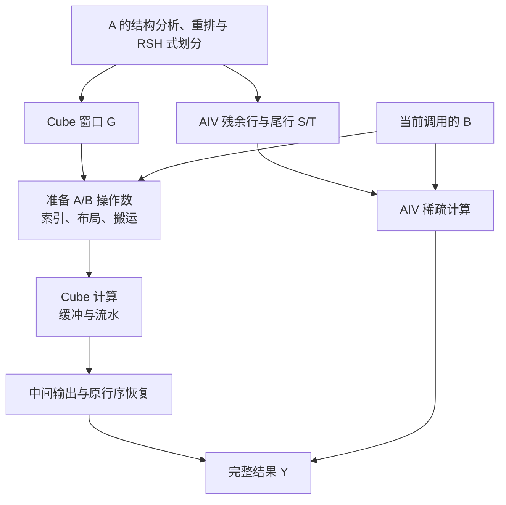
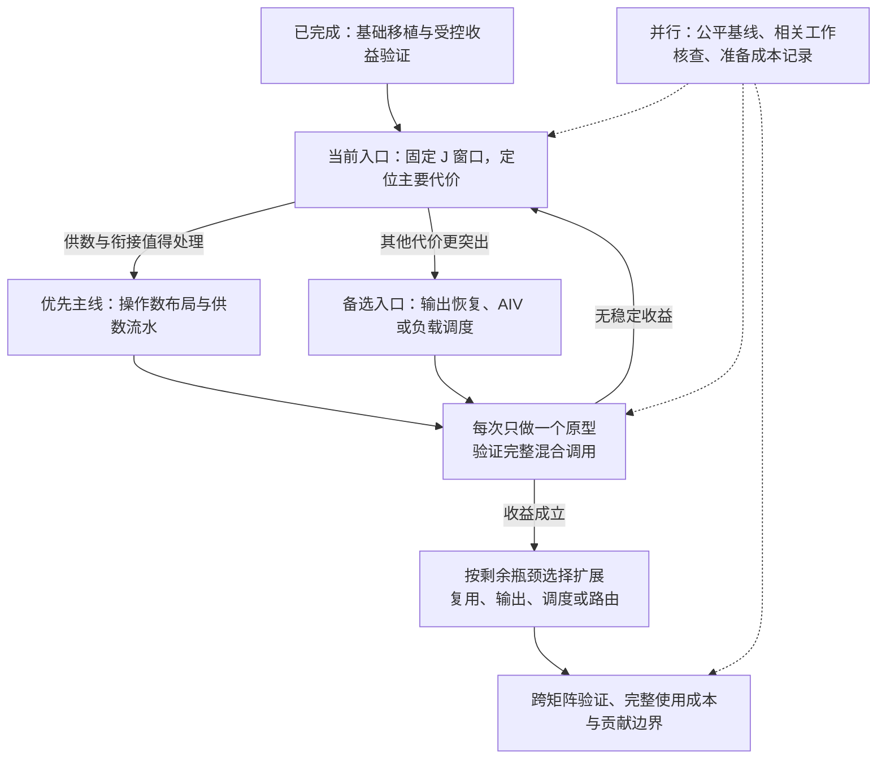
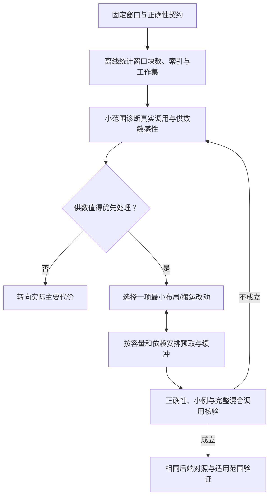

# RSH → 910B：整体设计路线与 Cube 供数主线

日期：2026-10-19。状态：研究路线草案，只有文档工作，没有启动新设备实验。

本图回应当前目标：先理解各模块的关系和大致顺序，再展开最近的设计任务。暂不按旧 D4–D6 建议推进；保留旧建议作为历史材料。新路线并不是已经批准执行的设备实验协议。

## 1. 当前站在哪里

已有六版本与 D0–D3 支持基础迁移的局部价值。D3 中 J 相对 L 综合约 1.108×，thermal/N64 约 1.63×、web/N64 约 1.38×，cit/N256 反而约慢 22.7%。这些数据支持一次有针对性的执行原型，不保证继续优化后必胜，不代表强库竞争力或完整应用收益。

可以保留 RSH 式重排/划分，把贡献放在 NPU 对细粒度窗口的执行机制。更换排序算法、发明新分流、超长行拆分都不是当前必经步骤。

## 2. 第一张图：一次计算中，各模块怎样连接

这是当前原型的主要工作关系，不是全部算子的精确时间线。最终输出及中间输出的必要清零仍须保留；图中为了突出数据关系省略了这些共同步骤。

四个层次分别是：选工作、准备数据、计算、交付输出。用户图中的 GPU 寄存器映射主要位于操作数准备和计算的交界处；到 910B，需要围绕实际数据布局、搬运接口、片上缓冲和依赖重做执行设计。

当前 G 与 S/T 的输出行归属互斥；这里的完整结果不是把同一行的两路部分和做归约。零行正确输出零。

“供给 Cube”本来包括 A 与 B。当前 A 已在预处理阶段展开为显式补零的 16×16 块，并非完整复制 RSH 的位图解码内核。第一项原型优先固定 A 格式、研究 B 和供数流水，是限制变量，不是认定 A 格式已经最优。

## 3. 第二张图：研究按什么顺序推进

实线表示主要推进或返回关系；虚线表示可并行的核查。节点是研究任务，不对应已授权的 D 编号。

扩展不是必做清单。如果一个机制已解决有价值的问题，可以进入完整验证；不需要把所有分支都实现。若完整使用成本不可接受，或强基线消除了原有优势，也可以缩小适用场景、换机制或停止该假说。

## 4. 后续模块之间的关系

| 模块 | 具体问题 | 与前后模块的关系 | 进入条件 |
|---|---|---|---|
| 操作数表示与布局 | A/B 怎样以 Cube 能直接消费的布局准备好？ | 布局决定搬运次数、转换代价与每块占用空间 | 当前先核查 B；A 表示暂固定并记录填充成本 |
| 窗口内供数流水 | 算当前块时，下一块能否提前准备？ | 与布局互相约束：缓冲容量决定预取深度，流水决定需要几份缓冲 | 供数/等待确有可处理成本 |
| 窗口间复用 | 不同窗口需要同样的 B 行时，能否减少重复准备？ | 依赖可用缓冲与调度；会影响负载均衡 | 重复访问足够、缓存之外仍有可利用空间 |
| 输出组织 | 中间写回与原行序恢复能否更便宜？ | 与行映射、写回粒度有关；前段变快后占比可能上升 | 诊断显示恢复值得处理，可提前成为主线 |
| AIC/AIV 调度及 AIV 执行 | 哪条路径拖后腿、核之间是否不均衡？ | 取决于真实后端速度；AIV 若辅助供数，还要承担残余计算资源竞争 | 观察到慢端、空闲或争用；AIV 基础质量同步核查 |
| 成本感知分流 | 当前后端上，哪些窗口还值得给 Cube？ | 应基于已测成本，后端变了规则可能需要调整 | 固定规则在特定结构/N 下反复失配时才进入 |
| 完整应用验证 | 一次性结构准备及每次 B 更新，会否抵消收益？ | 设计开始就记成本，集成后统一测量 | 每个候选都记录；形成主张前必须做完整比较 |

先后关系不是严格瀑布：通常先打通并验证小窗口的操作数路径，再做有效预取；二者要迭代。跨窗复用需要知道片上能保留多少数据，调度需要知道窗口实际成本；分流规则应参考这些真实成本。输出和 AIV 可以因诊断结果提前研究。

## 5. 展开最近任务：让细粒度窗口高效供给 Cube

### 5.1 任务定义

给定已经确定的 G/S/T 和一个当前有效的 B，在不改变这些行的归属与计算语义的条件下，让 Cube 更低成本地拿到 A/B 操作数，并检验是否缩短完整调用。

冻结逻辑窗口不等于冻结物理执行批次。仍可把同一窗口的多个 K16 块合成一批准备，或改变 N 方向处理粒度；这属于执行设计，不是重新分流，也不等于超长行跨路径拆分。

固定起点：D3 的 J 行序、窗口成员与路由，W16、阈值 8/4、精度、公共零行/尾行策略、完整原始输出，以及当前显式 A 块表示。保留已保存的原型作为对照。

### 5.2 子任务顺序

**第一步：看实际工作长什么样。** 离线统计每个窗口的 K16 块数、N、A 填充放大、B 引用序列、候选执行批次的工作集，以及输出量。用真实差异确定微基准范围，不盲目扫描所有参数。B 引用重复是机会指标，不是已经测得的 HBM 重复流量。

**第二步：判断供数有没有值得改善的空间。** 起点建议 thermal、web、cit 的代表配置，加 ns3Da 作为控制，覆盖已有 N=16/64/256；这是小范围诊断，不是新的正式测试集。先使用真实混合调用，再用独立 G/ST、设备时间线或专门微基准解释；不能相加/相减独立分支时间来推导真实重叠或精确瓶颈占比。

可加入 B 已按需要布局准备好的条件诊断，以观察移除不规则收集后的敏感性。它改变了存储/缓存条件，不是严格上限；未计准备成本时不能报告为实际方法加速。若所用工具无法直接分开收集与计算，就报告受限证据，不编造占比。

**第三步：只选一个机制原型。** 若细碎搬运和发指令值得处理，研究多个 K16 块的一批准备；若等待和供算衔接突出，研究下一块提前准备；若某些 N 带来布局/容量问题，研究相应的 N 分块。最初优先 AIC 自己完成的供数路径。让 AIV 辅助打包是后续可选方案，须额外计入 GM 中转、同步与 AIV 残余工作竞争，不能假设 910B 有其他代际的直接共享通路。

布局和流水一起核算：A/B/输出缓冲分别占多少空间、同时存几块、下一块什么时候可覆盖旧缓冲、哪些依赖必须等待。不能直接删 barrier，也不能把“有两块缓冲”当作已实现有效流水。

当前抽象顺序为：准备块 0 → 发出乘加及依赖同步 → 准备块 1 → …；源码不足以证明完全无硬件重叠。原型目标是显式组织：准备块 0 → 计算块 0 与准备块 1 在依赖允许时重叠 → 后续继续 → 完成尾段。是否真的重叠须验证。

**第四步：看完整调用是否获益。** 同一会话内比较旧/新版本，正式计时包含必要初始化、当前 B 所需的整理、计算、恢复与同步；诊断插桩结果另外保存。验证全输出、零行、尾窗、不对齐 N、小/空分支和连续 B 更新。每次 B 改变时要得到新结果；静态索引计划可复用，旧 B 的数值不能误用。

较少搬运指令、更短子核或更高 Cube 忙碌率都不是最终成功条件。需要完整调用改善超过同层计时波动，并没有用省略输出、旧 B、额外未计准备来取得优势。正式阈值与重复次数在设备协议中预先冻结，本路线图不事后指定数值门槛。

**第五步：确认改动改善了什么。** 将适用的新后端共同用于 L/F/J，保留整矩阵 AIV 对照，并逐步加入语义相符的外部强基线。最小核心是 L/J × 旧/新后端的交叉对照。先固定划分参数；只有证据表明后端变化导致规则失配，才在独立阶段校准规则。

### 5.3 结果如何决定下一站

| 观察 | 解释边界 | 下一站 |
|---|---|---|
| B 就绪诊断也几乎无变化 | 当前供数假说缺乏支持，或诊断不足以隔离它 | 检查 A 构造、恢复、AIV 或调度 |
| 诊断有明显变化，真实原型没有收益 | 可能尚未隐藏等待，或新增整理/同步抵消收益 | 检查原型代价；不把诊断值当正式结果 |
| 新后端让 L/J 都相近地变快 | 是有用的公共后端改进，尚未证明细粒度专用机制 | 保留改进，再检查更具体问题 |
| J 获益且在多个结构上可重复 | 支持继续研究面向细粒度窗口的执行设计 | 解释条件、检查相关工作、冻结后扩展矩阵 |
| 新后端后恢复成为主要代价 | 瓶颈位置移动 | 进入输出组织分支 |
| 窗口内已改善，跨窗 B 重复且仍有成本 | 跨窗复用开始具备前提 | 研究同核调度/有限驻留，计入均衡代价 |
| 强 AIV 基线消除混合优势 | 初始收益依赖较弱实现，需重新限定价值 | 缩小适用结构或停止当前混合假说 |

## 6. 何时形成自己的贡献

第一阶段做可信的基础执行：正确布局、必要同步、有效预取、公平计时。第二阶段从失败和成本中确定一个具体矛盾，例如细粒度结构选择与高效搬运批次之间的冲突，再设计能解决该矛盾的机制。第三阶段验证相对已有方法的差异、适用边界、代价和实际收益。

普通双缓冲、换接口、使用 AIC/AIV 本身不承担独立新颖性。沿用 RSH 的划分是允许的；执行机制若有实质新设计并经相关工作与实验支持，也可以作为论文贡献。创新候选不必等于新行排序或新分流。

较强基线和相关工作核查同步推进，不强制等全部外部复现完成才允许小原型，也不等最终写论文时才发现重复。每种格式从开始就记录 CPU 准备、内存占用与每次 B 更新成本。所有已有八矩阵都视为开发材料；后续新的泛化结论需冻结规则后使用未见矩阵。输入驻留优势与完整应用优势分别报告。

当前建议的下一份具体交付是：**固定 J 的供数诊断协议与单一原型选择依据**。先解释清楚并确认范围，再按用户指令执行该阶段；完成后保存数据与恢复信息、关机并停止。

## 来源

- [D3 结果](../../results/d3/结果解读.md)、[机制解读](../../results/d3/机制解读.md)。
- [当前 Cube/AIV 实现](../../npu/work.h)、[输出恢复](../../npu/restore.cpp)。
- [RSH §3.3.2](https://arxiv.org/html/2603.08734v1)。
- [NeutronSparse §6–7](https://arxiv.org/html/2606.22482v1)。
- [官方 LoadData 接口与产品限制](https://www.hiascend.com/document/detail/en/CANNCommunityEdition/910/API/ascendcopapi/docs/en/api/SIMD-API/basic_api/cube_compute_ISASI/cube_compute_load/Load2D.md)。文档版本与当前 CANN9.0.0 不同，设备实现前须核实当地头文件与支持路径。
